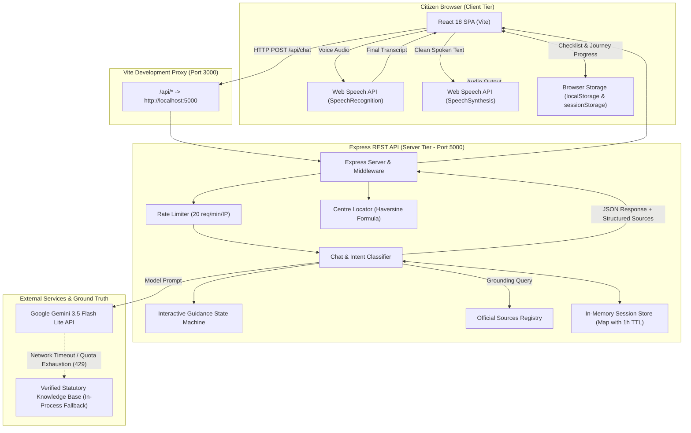
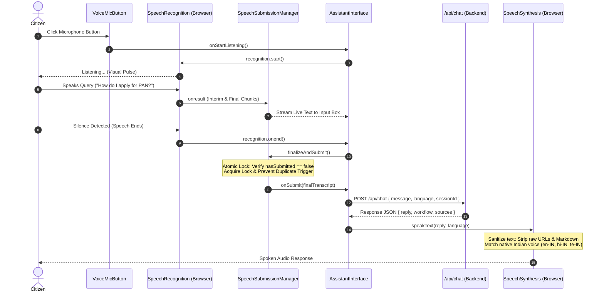
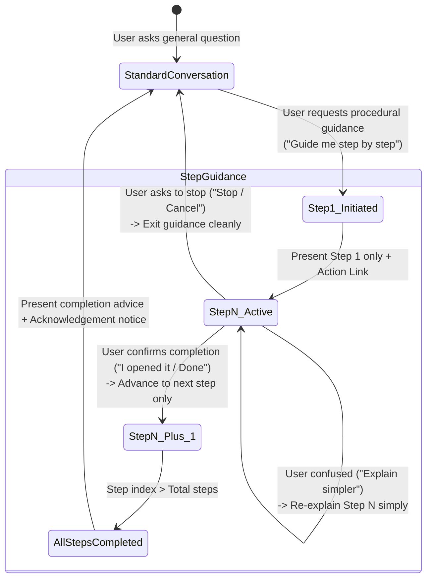

# Sahayak: System Architecture and Technical Specifications

This document details the architectural design, component hierarchy, data flows, and technical implementation of **Sahayak – Multilingual Voice Assistant for Indian Public Services**.

---

## 📑 Table of Contents

- [High-Level System Architecture](#-high-level-system-architecture)
- [Frontend Architecture & Component Hierarchy](#-frontend-architecture--component-hierarchy)
- [Backend Architecture & Core Services](#-backend-architecture--core-services)
- [Voice Interaction Pipeline (STT & TTS)](#-voice-interaction-pipeline-stt--tts)
- [Interactive Step-by-Step Guidance Engine](#-interactive-step-by-step-guidance-engine)
- [Client-Side State & Storage Architecture](#-client-side-state--storage-architecture)
- [Service Centre Locator & Distance Mathematics](#-service-centre-locator--distance-mathematics)
- [API Endpoints & Data Contracts](#-api-endpoints--data-contracts)
- [Security, Rate Limiting & Privacy Architecture](#-security-rate-limiting--privacy-architecture)

---

## 🏛️ High-Level System Architecture

Sahayak is built on a decoupled client-server architecture consisting of a React Single Page Application (SPA) frontend and a Node.js/Express REST backend, grounded by Google Gemini (gemini-3.5-flash-lite) and local statutory knowledge registries.



---

## 🧩 Frontend Architecture & Component Hierarchy

The frontend is implemented in React 18 using functional components, customized hooks, and modular UI layers.

### Component Tree
```
App.jsx (Root Application Component)
│
├── Navbar.jsx
│   ├── Language Selector (EN, HI, TE)
│   ├── Font Sizing Controls (A- / A+ : 14px – 22px)
│   └── High-Contrast Mode Toggle
│
├── LandingPage.jsx (Introductory View)
│   ├── Multilingual Information Cards
│   ├── Active Service Badges
│   └── "Start Conversation" Call to Action
│
└── AssistantInterface.jsx (Core Operational Dashboard)
    ├── Quick Suggestion Chips (Pre-formatted vernacular queries)
    │
    ├── Left Column (Interactive Dialogue & Readiness)
    │   ├── VoiceMicButton.jsx (Animated Pulse Mic with States: Idle, Listening, Thinking, Speaking)
    │   ├── ConversationDisplay.jsx (Chat Message History, Audio Replay & Container-Scoped Scroll)
    │   ├── Text Input Form (Keyboard fallback with manual send button)
    │   └── SmartDocumentChecklist.jsx (Document Readiness with Rule 114 badges)
    │
    └── Right Column (Procedural Milestones & Trust Grounding)
        ├── ApplicationJourneyTracker.jsx (Numbered step sequence & progress persistence)
        ├── SourcesPanel.jsx (Verified .gov.in sources with audit timestamps)
        └── CentreFinder.jsx (PIN code and GPS locator for physical counters)
```

### Component Roles & Responsibilities

| Component | Responsibility | Key State / Props |
| :--- | :--- | :--- |
| `AssistantInterface` | Root coordinator of voice states, messaging, active workflow tracking, and API calls. | `messages`, `status`, `currentWorkflow`, `language` |
| `VoiceMicButton` | Handles mic user interaction, audio cancellation, and dynamic visual pulse states. | `status` (`idle`, `listening`, `thinking`, `speaking`) |
| `ConversationDisplay` | Renders transcript bubbles, message audio replay triggers, and smooth auto-scrolling confined to the conversation container. | `messages`, `fontSize`, `language`, `onReplayAudio` |
| `SmartDocumentChecklist` | Manages document verification badges (`Required`, `Conditional`, `Depends on method`) and tracks preparation readiness. | `activeService`, `language`, `localStorage` persistence |
| `ApplicationJourneyTracker` | Visualizes the multi-step application workflow, qualified fee breakdowns, and completion milestones. | `activeService`, `language`, `localStorage` persistence |
| `CentreFinder` | Queries physical facilitation centres via postal PIN code, city name, or browser geolocation. | `pincode`, `lat/lng`, `serviceCentres` API |
| `SourcesPanel` | Displays official government statutory URLs, verifying organisations, and manual audit dates. | `sources`, `language` |

---

## ⚙️ Backend Architecture & Core Services

The backend is built as an asynchronous Node.js Express service located in `backend/`:

### 1. `server.js` (Application Gateway)
- Implements CORS and JSON body-parsing middleware.
- Enforces an IP-based rate limiter (`chatLimiter`) capping `/api/chat` requests at **20 requests per minute per IP**. Automated test suites supply an `x-test-suite: sahayak-tests` header to bypass throttling.
- Exposes REST endpoints: `/api/chat`, `/api/sources`, `/api/centres`, `/api/services`, and `/api/health`.

### 2. `services/chatService.js` (Orchestration & Intent Classifier)
- **Session Store:** In-memory `Map` associating session UUIDs with conversation history, active workflow, guidance state, and `lastActive` timestamps.
- **Session Cleanup:** Garbage collection purges sessions older than 1 hour (`SESSION_TTL_MS = 3600000`) and limits store size to 200 concurrent sessions.
- **Intent Classifier (`detectIntentAndWorkflow`):** Multilingual keyword and regex pattern matcher identifying:
  - Unsupported services (Voter ID, Passport, Driving Licence) across EN, HI, and TE.
  - Supported workflows (`pan_card` vs. `ayushman_bharat`).
  - Contextual follow-up queries (e.g., *"What documents do I need?"*, *"फीस क्या है?"*, *"తర్వాత ఏమిటి?"*).

### 3. `knowledge/interactiveGuidance.js` (Guidance State Machine)
- Maintains verified procedural step sequences for PAN Card (Form 93) and Ayushman Bharat PM-JAY.
- Evaluates user responses against:
  - `isStepConfirmation`: Detects phrases like *"I opened it"*, *"Done"*, *"हो गया"*, *"అయిపోయింది"*.
  - `isStepConfusionOrHelp`: Detects confusion and provides plain-language explanations.
  - `isStepExitRequest`: Detects cancellation phrases (*"stop"*, *"रुको"*, *"ఆపండి"*).

### 4. `services/gemini.js` (AI Model Integration)
- Configures Google Gen AI SDK (`@google/genai`) targeting `gemini-3.5-flash-lite`.
- Wraps API calls in a strict 6,000ms timeout promise (`callWithTimeout`) to prevent hanging network requests.
- Catches HTTP 429 quota exhaustion and 503 service unavailable errors, instantly routing to verified local fallback without retry delays.

### 5. `data/serviceCentres.js` (Service Centre Locator)
- Houses a curated sample directory of public Protean TIN-Facilitation Centres and CSC Seva Kendras with public addresses, coordinates, and contact details for demonstration, backed by official government portal locators for comprehensive searches.
- Computes spherical distance between user coordinates and centres using the **Haversine formula**.

---

## 🎙️ Voice Interaction Pipeline (STT & TTS)

The voice architecture guarantees single-submission locking, accent-safe speech synthesis, and zero page jumping.



---

## 🧭 Interactive Step-by-Step Guidance Engine

When procedural guidance is requested, Sahayak switches from standard single-turn answers to an interactive step-by-step state machine:



---

## 💾 Client-Side State & Storage Architecture

Sahayak maintains a strict boundary between ephemeral conversational memory and persistent user readiness tracking:

```
+-------------------------------------------------------------------------+
|                          BROWSER STORAGE TIERS                          |
+-------------------------------------------------------------------------+
|                                                                         |
|  1. sessionStorage (Tab-Isolated Ephemeral Context)                     |
|     - Key: 'sahayak_session_id'                                         |
|     - Value: RFC 4122 v4 UUID (e.g., '37d538b6-1322-417b-977d-...')     |
|     - Scope: Strictly isolated to current browser tab. Multiple tabs    |
|       maintain completely independent conversations.                    |
|                                                                         |
|  2. localStorage (Persistent Citizen Preparation Data)                  |
|     - Key: 'sahayak_tracker_pan'      -> Saved PAN milestone marks      |
|     - Key: 'sahayak_tracker_ayushman' -> Saved Ayushman milestone marks |
|     - Key: 'sahayak_checklist_pan'    -> Saved PAN document checks      |
|     - Key: 'sahayak_checklist_ayushman'-> Saved Ayushman document checks|
|     - Scope: Persists across browser refreshes and device restarts.     |
|                                                                         |
+-------------------------------------------------------------------------+
```

---

## 📐 Service Centre Locator & Distance Mathematics

The Centre Finder calculates geographical proximity between the citizen's GPS coordinates and authorized public service counters using the **Haversine formula**:

$$\Delta\sigma = 2 \arcsin \left( \sqrt{\sin^2\left(\frac{\Delta\phi}{2}\right) + \cos(\phi_1)\cos(\phi_2)\sin^2\left(\frac{\Delta\lambda}{2}\right)} \right)$$

$$d = R \cdot \Delta\sigma$$

Where:
- $\phi_1, \phi_2$ are the latitudes of the citizen and centre in radians.
- $\Delta\phi = \phi_2 - \phi_1$ is the latitude difference.
- $\Delta\lambda = \lambda_2 - \lambda_1$ is the longitude difference.
- $R = 6371\text{ km}$ is Earth's mean radius.
- $d$ is the calculated surface distance in kilometres.

Centres are filtered within a user-specified search radius (default: 50 km, capped between 5 km and 200 km) and returned sorted in ascending order of distance.

---

## 🔌 API Endpoints & Data Contracts

### 1. Main Chat Endpoint: `POST /api/chat`
**Headers:** `Content-Type: application/json`

**Request Payload:**
```json
{
  "message": "Guide me through applying for a PAN card step by step.",
  "language": "en",
  "sessionId": "405c06ae-67a2-502c-0e61-1ba9c6efb7a7"
}
```

**Response Payload:**
```json
{
  "reply": "Sure! I'll guide you through applying for a PAN card one step at a time.\n\nStep 1: Open the official Protean PAN application portal (https://onlineservices.proteantech.in/paam/endUserRegisterContact.html) and select the online application option.\n\nHave you opened the portal? Or do you need help with this step?",
  "language": "en",
  "workflow": "pan_card",
  "guidanceState": {
    "active": true,
    "step": 1,
    "totalSteps": 6
  },
  "sources": [
    {
      "id": "protean_pan",
      "title": "Protean eGov Technologies - Online PAN Application Portal",
      "organisation": "Protean eGov Technologies Limited (Authorised by Income Tax Department, GoI)",
      "url": "https://onlineservices.proteantech.in/paam/endUserRegisterContact.html",
      "lastVerifiedDate": "2026-10-15"
    }
  ],
  "verificationNotice": "Grounded in official Government of India sources (Income Tax Dept / Protean / UTIITSL) last manually verified in October 2026.",
  "timestamp": "01:15 AM"
}
```

### 2. Service Centre Search: `GET /api/centres`
**Query Parameters:**
- `service`: `'pan_card'` | `'ayushman_bharat'`
- `pincode`: 6-digit postal code (e.g., `500001`)
- `query`: Text search string (e.g., `"Hyderabad"`)
- `lat` / `lng`: Latitude / Longitude floats
- `radiusKm`: Search radius integer (5 – 200 km)

**Sample Response:**
```json
{
  "service": "pan_card",
  "totalFound": 1,
  "centres": [
    {
      "id": "pan_protean_hyd_01",
      "name": "Protean TIN-FC & PAN Service Centre - Abids",
      "centreType": "protean_tinfc",
      "authorisedBy": "Income Tax Department (via Protean eGov Technologies Ltd)",
      "pincode": "500001",
      "address": "Shop No. 4, Ground Floor, Babu Khan Estate, Bashirbagh / Abids, Hyderabad",
      "city": "Hyderabad",
      "state": "Telangana",
      "distanceKm": 3.3
    }
  ],
  "fallbackLocators": [
    {
      "provider": "Protean eGov Technologies (formerly NSDL)",
      "portalName": "Official Protean TIN-Facilitation Centre & PAN Centre Locator",
      "url": "https://www.tin-nsdl.com/tin-facilities.html"
    }
  ]
}
```

---

## 🔒 Security, Rate Limiting & Privacy Architecture

1. **Strict Zero-Credential Architecture:**
   - Sahayak's codebase contains no forms, fields, or parameters designed to capture or store Aadhaar numbers, OTPs, PINs, passwords, or payment cards.
   - User inputs containing sensitive terms trigger an advisory redirecting them to official government portals.
2. **IP Rate Limiting:**
   - Protects the `/api/chat` route from abuse with an Express rate limiter enforcing 20 requests per minute per IP.
   - Throttled requests receive an HTTP 429 response with a user-friendly retry message.
3. **Session Privacy:**
   - Sessions are ephemeral in-memory references identified by randomized UUIDs.
   - Sessions automatically expire and are purged after 1 hour of inactivity.
4. **Resilient Local Fallback:**
   - If the Gemini API experiences network timeouts, HTTP 429 quota exhaustion, or service unavailability, Sahayak automatically engages its in-process verified knowledge base, ensuring citizens receive immediate, grounded guidance without external AI model downtime (client-side speech recognition and web assets still require browser connectivity).
